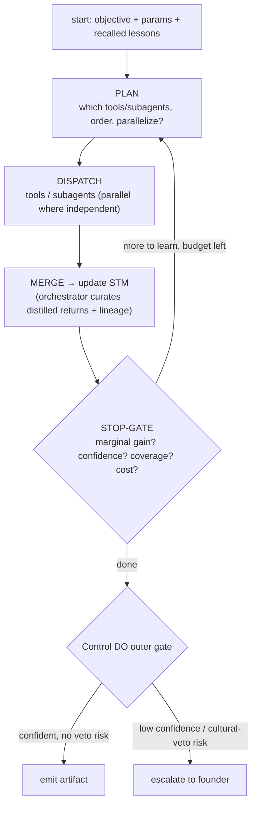

# Karkhana — Agent Kernel: the reusable agent anatomy

> **Status: design / brainstorm.** Nothing here is built yet. This is the agreed
> *direction*, captured so decisions aren't lost. Treat it as living.
>
> This is the **base pattern every agent in the system is an instance of** — orchestrator
> or subagent, online or offline. It concretizes the single-agent anatomy sketched in
> [AGENT-PLATFORM.md](./AGENT-PLATFORM.md) (manifest, `ModelPort`, `MemoryPort`, reflection)
> and is the unit that [ORCHESTRATION.md](./ORCHESTRATION.md) composes into a topology. The
> first and reference instance is the [Creative Head](./CREATIVE-HEAD.md). Read those for
> the *platform* and the *topology*; this is the *cell*.

## 1. What the kernel is

> **Decision (AK-1): there is one agent shape, the Kernel. Every agent is the Kernel
> instantiated by a manifest.** "Build a new agent" = write a manifest + prompts, not write
> a new runtime. "Make an agent more capable" = add/improve its subagents, never thicken the
> orchestrator (inherits OR-1).

The Kernel is the fixed set of capabilities each agent gets for free:

| Capability | Provided by |
|---|---|
| **Any LLM** | `ModelPort` (Vercel AI SDK) routed through AI Gateway (AP §7) |
| **Long-term memory** | `MemoryPort` — one store, scoped namespace (§3, AP §3) |
| **Working memory (STM)** | In-context working set + durable run-log, with compaction (§3) |
| **Bounded reflect-loop** | Recall → plan → act → update → stop-gate, calibrated stop (§2, §5) |
| **Subagent dispatch** | Subagent-as-tool with a context firewall (§4) |
| **Reflection** | Generate → critique → revise against a rubric (AP §5) |
| **Outer governance** | Control DO gate: ship vs escalate (§6) |
| **Versioned prompts** | Every LLM call resolves its prompt from Langfuse (§7) |
| **Observability** | One `agents/observability` stream, structured events (§9) |
| **Config** | The manifest, BO-editable (§8) |

A **subagent is itself a Kernel instance** — its own loop, its own scratch memory, its own
manifest entry. It is *invoked as a tool* with `{ objective, params, stm_projection }` and
returns `{ artifact, lineage }`. There is no second, lighter "subagent runtime."

## 2. The loop (one iteration)

Every Kernel runs the same bounded loop **inside a single invocation** (not an outer
re-invocation loop — AP/OR distinction preserved):



The STOP-GATE (§5) is the *intended* exit; `max_loops` is only a backstop. Compaction
(§3) fires whenever STM approaches the model's context budget, transparently — it does not
count as a loop.

## 3. Memory model

Two distinct memories, easily conflated, with different write paths and trust models. (The
third "memory," the Catalog View, is *world state*, not the agent's — it lives in
[ORCHESTRATION.md](./ORCHESTRATION.md) §3 and is read, never owned, by the Kernel.)

### 3.1 Working memory (STM) — per run, orchestrator-owned

STM is the agent's scratchpad for *this* run: plan, distilled findings + decision lineage,
coverage map, open hypotheses, the artifact draft. It has **two faces**:

- **In-context working set** — compact, always present in the orchestrator's prompt. This
  is "STM is added to the model's context every loop."
- **Durable run-log (D1)** — the full, append-only record. Compaction is **lossy in
  context only**; nothing is lost on disk. Re-summarization reads from here.

Three rules keep STM safe to share (this reconciles "STM is passed to every subagent" with
the context firewall, OR-3):

> **Decision (AK-2): STM is orchestrator-owned, projected read-only to subagents, and only
> the orchestrator mutates it.**
> 1. **Subagents never write STM directly.** They return a distilled artifact + lineage;
>    the orchestrator decides what to merge. "Update STM" is the orchestrator's curate/compact
>    operation, not a free-for-all.
> 2. **Pass a *scoped projection*, not the whole blackboard.** Handing full STM to N
>    subagents re-inflates the bloat the firewall exists to kill — and pays it N times. Each
>    subagent sees only the slice its objective needs.
> 3. **Compaction is a first-class, Langfuse-prompted call** (`kernel/compactor`), triggered
>    on context-budget pressure; the full version persists in the run-log.

### 3.2 Long-term memory (LTM) — across runs, one store, scoped

> **Decision (AK-3): one `MemoryPort` store (D1 + Vectorize), partitioned by
> `namespace = agent_id + domain scope` — never a separate store per agent/subagent.** A
> store-per-agent fragments the learning loop and creates a "which memory is authoritative"
> problem. Subagents that belong to one agent share its namespace; a genuinely shared service
> (e.g. a reusable Research subagent) gets its own.

Holds episodic / semantic / procedural lessons (AP §3). The Kernel reads via scoped hybrid
recall at loop start; it **writes append-only episodic records inline**. The
*consolidation* (reinforce / supersede / decay) is done **offline** by the Consolidation
agent (ORCHESTRATION §4), and only for **verified outcomes** (AP-6). This is the guardrail
against self-poisoning: an agent never promotes its own ungraded output to a behaviour-
changing lesson within the same run.

## 4. Subagent-as-tool + the context firewall

```
orchestrator ──{ objective, params, stm_projection }──▶ subagent (own loop, own scratch)
orchestrator ◀──{ artifact, lineage }──────────────────  (raw transcript stays ephemeral)
```

> **Decision (AK-4): the firewall is non-negotiable. A subagent may burn a large context
> internally but returns only a distilled artifact + decision lineage.** The orchestrator's
> context never sees a raw subagent transcript. Cross-subagent sharing is **only through the
> orchestrator** (no cross-agent state leakage — ORCHESTRATION open-Q resolved this way).

Every dispatched return carries **decision lineage** (which signals / recalled lessons led
to it). Lineage is load-bearing twice: the Control DO review reads it, and the learning
loop grades it (a vetoed decision must not teach "do more of this"). Lineage replaces
user-facing citations (OR-5).

## 5. Calibrated stop — no hard budget

> **Decision (AK-5): stopping is calibrated by marginal value, not capped by a token
> budget. `max_loops` exists only as a circuit-breaker.** Tune agents to stop on best effort
> whenever further work stops paying.

Each loop the orchestrator self-assesses a small set of orthogonal signals:

| Signal | Stops when |
|---|---|
| **Marginal info gain** | The last loop didn't materially change the draft / close a gap / resolve a hypothesis (below `marginal_gain_min`) |
| **Confidence-to-ship** | The draft clears `confidence_min` on its load-bearing claims, and anything cultural-veto-adjacent is *grounded*, not guessed |
| **Coverage** | The objective is answered across its required axes |
| **Soft cost reflection** | Told its cost-so-far, the agent must *justify* continuing ("diminishing returns?") — a prompt, not a ceiling (`soft_cost_note`) |

`max_loops` (manifest `stop.max_loops`) fires only if none of the above trip first.
**Every level has its own** — orchestrator, each subagent, and anything they spawn (OR-6).
Depth is never unbounded.

## 6. Control DO outer gate — ship vs escalate

The STOP-GATE decides *when* to stop; the Control DO decides *what stopping means*, per the
agent's `autonomy` mode:

| Mode | Behaviour |
|---|---|
| `manual` | No inner loop; answers a direct question from cheap reads only |
| `proposes` (default for consequential writers) | Inner loop runs to completion; output is **drafted**, not committed — founder reviews |
| `auto` | Inner loop + outer reflection gate; low-risk outputs execute; **low confidence or cultural-veto risk still escalates** |

Stopping therefore has two flavours: **stop-and-ship** vs **stop-and-escalate** (AP-3,
ORCHESTRATION §5).

## 7. Prompts from Langfuse — versioned

> **Decision (AK-6): every LLM call resolves its prompt from Langfuse by `name@label`; no
> prompt strings live in code.** The manifest holds the *references*; the Kernel resolves at
> runtime.

- Resolution is by `name@label` (e.g. `creative-head/orchestrator@production`,
  `kernel/compactor@production`).
- **Cache + last-known-good fallback** so a Langfuse outage can't halt a run.
- The **resolved prompt version is written into the run trace** (correlation IDs, CP §13),
  so any artifact is reproducible.
- Clean separation of concerns: **AI Gateway** does model routing/caching/cost; **Langfuse**
  is the prompt registry + LLM-call tracing + eval datasets. Langfuse traces sit *next to*
  the `agents/observability` stream (§9), not instead of it.

## 8. Configuration is the manifest

Everything an operator can change about a Kernel is a manifest field (AP-4) — the BO edits
it, the Kernel reads it, an engineering agent edits the same file in git. The Kernel-level
fields (on top of AGENT-PLATFORM §9):

- `prompts{}` — name→Langfuse-label map (§7)
- `subagents[]` — the dispatch table: `{ id, prompt, tools, max_loops, parallel_ok }` (§4)
- `stop{}` — `marginal_gain_min`, `confidence_min`, `soft_cost_note`, `max_loops` (§5)
- `sampler{}` — `{ enabled, max_samples }` for agents that probe hypotheses
- plus the existing `model`, `memory`, `tools`, `autonomy`, `schedule`, `scopes`,
  `reflection` fields.

Tools and MCP connections are per-agent and scope-bounded by the service account (AP-5): an
agent can't call a tool its manifest doesn't grant.

## 9. Observability — one stream

Each Kernel (and each subagent) is an `AsyncGenerator` yielding into the shared
`agents/observability` stream (OR-7). The orchestrator re-yields subagent events
(`async for event in subagent.run(): yield event`). Structured events with stable
`tool`/`step` codes; localize labels in the BO (vernacular product — never bake English
into the stream). Two events per step (`complete=false`/`true`); one shared `EventIdManager`.

## 10. Artifact format — Markdown-first

> **Decision (AK-7): every artifact an agent *emits* is Markdown, for readability.**
> Machine-required fields ride in **YAML frontmatter** (or a fenced metadata block); the body
> is human-readable narrative. This applies to agent **outputs/artifacts** — the Content
> Strategy, research findings, analysis reports, sampler scorecards, distilled subagent
> returns, the Notion renders. It does **not** apply to **configuration** (the manifest is
> **YAML** — AP-7) or **internal DB rows** (D1 episodic/semantic records, the Catalog View) —
> those are native structured data, not "outputs."

An artifact that is *also* a contract (the Content Strategy a downstream agent executes)
keeps its **machine-readability via the frontmatter** — CP-3's guarantees (immutable,
versioned, reproducible) stay intact and the frontmatter is JSON-schema-validatable. The
discipline that makes it safe:

- **Frontmatter is the contract; the body is for humans.** Anything a downstream agent must
  act on lives in the structured frontmatter; the prose body is *never* authoritative for
  execution (mirrors the lineage discipline in §4).
- **One artifact = one Markdown file**, versioned and content-addressed (`strategy@v7.md`).
  Markdown diffs cleanly in git/PRs — the founder reviews a readable diff, not a JSON blob.
- **Subagent returns are Markdown too** (distilled finding + a small frontmatter for typed
  signals like scores/confidence), so the orchestrator merges readable artifacts into STM.

## 11. Decisions log

| # | Decision | Rationale |
|---|---|---|
| AK-1 | **One agent shape; every agent is the Kernel + a manifest** | New agent = config, not a new runtime; capability grows via subagents not a fatter orchestrator |
| AK-2 | **STM is orchestrator-owned, projected read-only to subagents, mutated only by the orchestrator** | Reconciles "STM passed to every subagent" with the context firewall; bounds re-inflation |
| AK-3 | **One `MemoryPort` store, scoped by `agent_id + domain`** | Avoids per-agent fragmentation + "which memory is authoritative"; shared services get their own namespace |
| AK-4 | **Subagent-as-tool with a hard context firewall; distilled artifact + lineage out** | Orchestrator stays fast/cheap; provenance feeds Control DO review + the learning grade |
| AK-5 | **Calibrated stop (marginal gain / confidence / coverage / soft cost); `max_loops` = backstop** | Best-effort stopping without a hard budget; every level bounded |
| AK-6 | **All prompts from Langfuse by `name@label`, version logged in the trace** | Versioned, reproducible, BO/agent co-editable; outage-safe via cache |
| AK-7 | **Agent outputs/artifacts are Markdown** (YAML frontmatter for machine fields); manifest + DB rows excepted | Readable artifacts + clean PR diffs without losing machine-readability/reproducibility |

## 12. Relationship to other docs

| Doc | Relationship |
|---|---|
| [AGENT-PLATFORM.md](./AGENT-PLATFORM.md) | The platform (substrate, ports, manifest schema). The Kernel is its anatomy made concrete and reusable. |
| [ORCHESTRATION.md](./ORCHESTRATION.md) | The topology: how Kernel instances (orchestrator + subagents, online + offline) compose. |
| [CREATIVE-HEAD.md](./CREATIVE-HEAD.md) | The first and reference Kernel instance. |
| [ARCHITECTURE.md](../ARCHITECTURE.md) | Control DO, two-plane model, observability the Kernel plugs into. |
| [BACK-OFFICE.md](../BACK-OFFICE.md) | The BO surfaces that render the manifest + observability stream. |
