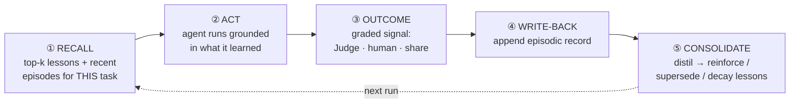

# Karkhana — Agent Platform: how we build & manage agents

> **Status: design / brainstorm.** Nothing here is built yet. This is the agreed
> *direction*, captured so decisions aren't lost. Treat it as living.
>
> This is the **"how do we actually build, run, and manage agents"** doc. It extends
> [ARCHITECTURE.md](../ARCHITECTURE.md) (two-plane model, Control DO, observability),
> [CREATIVE-PLANE.md](../CREATIVE-PLANE.md) (the agent *org chart*, registry, run console —
> CP §1, §12) and [BACK-OFFICE.md](../BACK-OFFICE.md) (the substrate: Agents SDK +
> Workflows + Vercel AI SDK behind ports — BO-2). Read those first; vocabulary is reused.

## 1. The requirements & the one big fork

The asks: **memory · MCP · tool calling · reflection loop · an interface to design and
manage agents · database connectivity · scheduling · use any LLM · effectively unlimited
context.** All of these are achievable — but the *first* decision determines everything:

> **Low-code visual agent builder (Dify / Langflow / Flowise / Sim Studio) vs.
> code-first framework + a management UI?**

**Decision (AP-1): code-first agents on the Cloudflare Agents SDK, managed through the
BO's registry/run-console/Mission-Control surfaces — NOT a drag-and-drop builder as the
substrate.** Visual builders are kept only as throwaway *prototyping* sketchpads.

Why, specifically for this product:

- **It contradicts the founding principle.** Karkhana is **agent-operated and built by
  engineering agents + Claude Code** (ARCH §1). A drag-drop GUI is a **human-authoring**
  tool. We already **dropped n8n** for exactly this reason (D2): the operators are agents,
  not humans wiring boxes. A visual builder re-creates the n8n problem one layer up.
- **It breaks everything-CF and the local-dev story.** Dify (Python + Celery + Redis) and
  Langflow (Python) run **their own runtime**, not `workerd`. Adopting one fragments the
  stack we just designed (BO-1: one runtime everywhere, `wrangler dev` + Docker mesh) and
  splits state/observability/secrets across two worlds.
- **Agents must be versioned, diffable, reviewable code.** Engineering agents and Claude
  Code edit **code + a manifest in git** (PR-reviewed, CODEOWNERS, CI). A builder hides
  logic in its own DB — un-diffable, hard for an agent to evolve, no clean audit.
- **"Manage agents" ≠ "author agents in a GUI."** The management need (see/run/schedule/
  configure/observe) is real and is the **BO** (CP §12). The *design* of an agent is its
  **manifest** (§9) — declarative config that a human *or* an agent can write.

Landscape we evaluated (all self-hostable, all have a canvas) — none becomes the runtime:

| Tool | Strength | Why not our substrate |
|---|---|---|
| **Dify** | Most complete platform (RAG, knowledge base, publishing) | Python/Celery runtime; off-CF; GUI-authored |
| **Langflow** | Most powerful; MCP server/client; deploy-flow-as-MCP | Python/LangGraph; off-CF; complex |
| **Flowise** | Fastest to first agent; HITL | LangChain/Node but own runtime; bolted-on scheduling |
| **Sim Studio** | TypeScript, fast-growing, deploy as REST/cron | Own Next/Postgres runtime; still GUI-as-source-of-truth |

We **borrow ideas** (Langflow's deploy-as-MCP, Dify's eval/observability UX) into our own
BO, but the source of truth stays **code + manifest on Cloudflare**.

## 2. The substrate — Cloudflare Agents SDK + Workflows (recap, then mapped)

Confirmed in BO-2. Every requirement maps to a native primitive — there is no capability
gap that forces us off-platform:

| Requirement | How (Cloudflare-native) |
|---|---|
| **Memory + learning loop** | Long-term memory we **own** in **D1 + Vectorize** behind a `MemoryPort` (recall → act → grade → write-back → consolidate); managed services (CF Agent Memory / Letta / Zep / Mem0) are optional adapters (§3) |
| **MCP** | Agents SDK is an **MCP client *and* server**; **Code Mode** turns MCP tools into a typed TS API the LLM writes code against |
| **Tool calling** | First-class tools; tools can be local functions, service bindings, or MCP tools |
| **Reflection loop** | A **Workflow** loop (generate → critique → revise) with a max-iteration cap + Control DO threshold (§5) |
| **Design/manage UI** | **Manifest** (declarative) + BO **registry / run console / Mission Control canvas** (§9; CP §12, ARCH §4) |
| **Database connectivity** | **D1** binding direct; external Postgres via **Hyperdrive** or a **Postgres MCP** server; R2/KV/Vectorize bindings (§6) |
| **Scheduling** | **Agents scheduled tasks** (cron) + **Cron Triggers**; webhooks/email/queue triggers; schedule lives in the manifest (§8) |
| **Use any LLM** | **Vercel AI SDK** behind `ModelPort` + **AI Gateway** routing; per-agent model in the manifest; Ollama locally (§7; BO-2) |
| **Unlimited context** | Not literal — achieved by **memory + scoped retrieval**, not a bigger window (§3) |
| **Long-running / durable** | **Workflows** (durable, retriable) + Agents-SDK durable execution; sub-agents with isolated SQLite + RPC |

## 3. Memory & the cross-run learning loop

The requirement is **long-term memory that updates on every run, stays fresh, is recalled
at runtime, and makes the agent learn** — an inbuilt learning loop. This is **distinct
from** within-run reflection (§5, intra-run self-correction) and from working-window
management. It is **inter-run learning**: the agent gets better the more it runs.

**Decision (AP-2): we own the long-term memory on primitives we control — D1 (structured)
+ Vectorize/Qdrant (semantic) behind a `MemoryPort`.** Managed services are **optional
adapters behind the same port, never a dependency**:

- **Default (own-the-data):** memory rows live in **our D1**, embeddings in **Vectorize**
  (Qdrant locally via the `VectorIndex` port, BO-3). Nothing here depends on a beta. This
  is the one we build.
- **Optional adapters:** **Cloudflare Agent Memory** (CF-native managed extract/recall —
  *private beta, so an adapter, not the base*), **Letta** (OS-style self-editing tiered
  memory, strong for long-horizon autonomy), **Zep** (temporal knowledge graph — "when was
  this true", good for our calendar-keyed facts), **Mem0** (consumer "remember-the-user").
  We benchmark these behind the port; we are never blocked on one. ([CF Agent Memory](https://blog.cloudflare.com/introducing-agent-memory/), [Letta/Zep/Mem0 compare](https://dev.to/agdex_ai/ai-agent-memory-in-2026-mem0-vs-zep-vs-letta-vs-cognee-a-practical-guide-cfa))

### The memory model — three kinds, one store

| Kind | Holds | Mutability |
|---|---|---|
| **Episodic** | one record per run: task ref (brief/theme/occasion/locale), the decision made, and the **outcome signal** | append-only |
| **Semantic** | learned facts ("Tamil Diwali sets perform best with *kolam* motifs") | versioned, **supersedable** |
| **Procedural** | distilled **lessons / strategies** the agent applies next time — *this is the learning* | reinforced / decayed / retracted |

### The loop (every run)



1. **Recall (read).** Scoped, hybrid (semantic + keyword + recency) retrieval of the
   lessons + recent episodes relevant to *this* task — injected as a compact "what I've
   learned" preamble. Scope tightly by agent + domain (locale/deity/theme); never dump the
   whole store.
2. **Act.** The agent runs with that grounding.
3. **Outcome.** Capture a **grounded** result — the **Judge scorecard** (CP §8), **human
   validation** when N>0, and later the **share-intent signal** (DISTRIBUTION Loop B / CP §15).
4. **Write-back.** Append an episodic record (decision + outcome) — "updates every run."
5. **Consolidate ("kept fresh").** Distil episodes into procedural/semantic memory:
   **reinforce** a lesson (↑confidence/support), **supersede** a contradicted one,
   **decay** stale ones, dedup. Runs as a Workflow step or a scheduled **Memory service**
   (the shared-service pattern, CP §3). This closing step is what makes it a *learning*
   loop rather than a log.

### Guardrails — what keeps the loop from poisoning itself (AP-6)

An autonomous system that learns from its own unverified output **drifts and compounds
errors**. The non-negotiables:

- **Learn only from verified outcomes.** A run's output becomes a durable *lesson* only
  once a real signal grades it (Judge pass / human-validated / actual share signal).
  Ungraded runs stay episodic until a signal arrives. (Ties to escalate-on-low-confidence,
  ARCH §3, and the cultural-correctness veto, CP-4 — a vetoed piece never teaches "do more
  of this.")
- **Evidence before influence.** One run is an anecdote; a lesson only *changes behaviour*
  after **N consistent observations** (mirrors validator consensus, CP §8). Confidence +
  support count are stored and gate recall weight.
- **Supersede, don't accumulate.** Conflicting facts → newer validated one wins (Zep-style
  validity windows); keep history for audit, recall only active.
- **Decay + calendar-keying.** Lessons lose weight with staleness; **time-bound** lessons
  (festival-specific) are keyed to the events calendar (CP §10) so they resurface on time
  and don't pollute off-season.
- **Auditable + human-steerable.** Every memory write is a structured event (CP §13); the
  BO can show "why the agent believes X," and the founder can **pin, edit, or retract** a
  lesson (narrative directives, CP-13). Memory is not a black box.

> Don't conflate three different "memories": **(1) catalog-as-knowledge** (the multimodal
> index — what content exists, CP §16), **(2) this learning memory** (what worked, the
> lessons), and **(3) working-window memory** (the current run). This section is **(2)**.

## 4. Tool calling & MCP

- **Tools** are declared per agent (in its manifest, §9): local functions, **service
  bindings** to other workers (the shared-services pattern — Documentation Agent, Events
  Calendar Agent, CP §3), or **MCP** tools.
- **MCP both ways:** agents consume external MCP servers (discovering tools at runtime) and
  can *expose* themselves as MCP servers so other agents call them. **Code Mode** compiles
  MCP tools into a typed TS API the model writes code against — fewer tokens, higher
  accuracy than raw tool-call JSON.
- **Authz on tools:** an agent's tools are bounded by its **service-account scopes** (BO-10).
  An agent can't call a tool its manifest/role doesn't grant — important for autonomy
  safety.

## 5. Reflection loop

Reflection (generate → self-critique → revise) is one of the four agentic patterns and is
worth ~10–20% on reasoning/quality tasks. **We already have a domain-specific reflection
loop designed: the auto-eval + Judge in CREATIVE-PLANE §8.** Generalize it:

- Implement as a **Workflow loop**: produce → evaluate against the **rubric** → if below
  threshold, feed the critique back and revise → repeat to a **max-iteration cap**.
- Store critiques as **episodic memory** (Reflexion-style verbal self-critique) so later
  runs learn from past mistakes.
- The **stop condition is Control-DO-governed** (escalate-on-low-confidence, ARCH §3): if
  the agent can't clear the bar in N tries, it **escalates to a human** instead of looping
  forever or shipping weak output. For devotional content the **cultural-correctness veto**
  (CP-4) is a hard gate inside this loop, never an averaged score.

## 6. Database connectivity

- **First-party:** D1 / R2 / KV / Vectorize via **bindings** (no network credentials in
  code — the binding *is* the auth).
- **External SQL** (if ever needed): **Hyperdrive** for pooled low-latency Postgres/MySQL,
  or a **Postgres MCP server** when an agent should explore a DB as a tool.
- Agents touch data **through tools/services**, not ad-hoc — so every DB access is typed,
  logged (CP §13 correlation IDs), and scope-checked.

## 7. Use any LLM

Recap BO-2: **`ModelPort` (Vercel AI SDK) + AI Gateway.** Each agent's manifest names its
model(s); switching is config. AI Gateway gives routing, fallback, caching, and per-call
cost/latency logs in staging/prod; local dev points the port at **Ollama**. Per-surface
model choice (which agent uses which model) is a manifest field, A/B-able later.

## 8. Scheduling

No bespoke scheduler (CP §12): **Agents scheduled tasks** (cron expressions) +
**Cron Triggers**, plus webhook/email/queue triggers. The **schedule lives in the agent's
manifest**; the BO writes it, CF executes it. Long-lead jobs (e.g. the Events Calendar
Agent refreshing festivals months ahead, CP §3/§10) are just cron entries.

## 9. The "design & manage" interface (what you actually clicked for)

The interface you want is **two declarative things + the BO**, not a flow canvas:

**(a) The agent manifest — the design surface.** Every agent is defined by a versioned
**YAML** manifest (extends CP §12's registry manifest):

```yaml
agent_id: creative-head
role: CPO + Creative Director
kind: pipeline | shared-service
model: { port: ModelPort, primary: "…", fallback: "…" }                 # any LLM
memory: { port: MemoryPort, impl: d1+vectorize, scope: locale+theme }   # §3
learning: { min_support: 3, decay_days: 90 }                            # §3 loop
prompts:                                                                # Langfuse, versioned (kernel §7)
  orchestrator: creative-head/orchestrator@production
  compactor:    kernel/compactor@production
tools: [mcp:notion, svc:events-calendar, fn:catalog.query]              # §4
subagents:                                                              # dispatch table (kernel §4)
  - { id: catalog-research, prompt: creative-head/catalog-research@production,
      tools: [mcp:d1, fn:catalog.knn, fn:aLLM.analyze], max_loops: 4, parallel_ok: true }
  - { id: web-research, prompt: creative-head/web-research@production,
      tools: [svc:browser-render, fn:web.search], max_loops: 3, parallel_ok: true }
  # …code-exec, memory, strategy-read, content-sampler — see agents/CREATIVE-HEAD.md
io_schema: { input: objective+narrative?, output: strategy@vN }         # single artifact
autonomy: auto | proposes | manual                                      # Control DO
schedule: "0 6 * * *"                                                   # §8
scopes: [strategy:create, agent:run]                                    # RBAC (BO-10)
reflection: { rubric: rubric@v3, max_iters: 3 }                         # §5
stop:                                                                   # calibrated stop (kernel §5)
  marginal_gain_min: 0.15
  confidence_min: 0.8
  soft_cost_note: true
  max_loops: 8            # max_loops = backstop, not the stop
sampler: { enabled: true, max_samples: 6 }                              # hypothesis probe (kernel)
last_run: "…"
version: 7
```

A human edits this in the BO; **Claude Code / an engineering agent edits the same file in
the repo.** Same source, two authors — that's the whole point. The `prompts`, `subagents`,
`stop`, and `sampler` blocks are the **Agent Kernel** fields every agent shares —
see [agents/AGENT-KERNEL.md](./AGENT-KERNEL.md); the Creative Head's full roster and the
single `strategy@vN` artifact are in [agents/CREATIVE-HEAD.md](./CREATIVE-HEAD.md).

**(b) The BO management surfaces** (CP §12, already designed): **agent registry** ("the
workforce" — every manifest, last run, cost, autonomy), **run console** (kick off on
demand, watch the live `agents/observability` stream), **Mission Control canvas** (live
agent topology + state — the n8n-canvas replacement, ARCH §4), **review/approve**, **audit
log**. This is the "easily design and manage agents" UI — config + observability, not
authoring-by-dragging.

## 10. Decisions log (extends ARCH, CP, BO logs)

| # | Decision | Rationale |
|---|---|---|
| AP-1 | **Code-first agents on the Agents SDK + BO management UI**; reject visual builders as the substrate | Agent-operated/Claude-Code-built product; versioned/diffable; everything-CF; builders re-create the n8n problem (D2) |
| AP-2 | **Own the long-term memory in D1 + Vectorize behind a `MemoryPort`**; CF Agent Memory / Letta / Zep / Mem0 are optional adapters, never a dependency | "Unlimited context" via recall not bigger windows; not blocked on a private beta; port avoids lock-in |
| AP-3 | **Reflection loop = Workflow generate→critique→revise**, capped, Control-DO stop/escalate; reuses the Judge/rubric (CP §8) | Quality uplift without infinite loops; cultural-veto stays a hard gate; humans catch the hard cases |
| AP-4 | **The agent manifest is the design surface**; BO registry/console/canvas is the management surface | "Design & manage" without GUI-as-source-of-truth; human and agent edit the same file |
| AP-5 | **Tools/DB access are scope-bounded by the agent's service account** (BO-10) and go through typed tools/MCP | Autonomy safety + auditable data access |
| AP-6 | **Cross-run learning loop** (recall→act→**grade**→write-back→consolidate); **learn only from verified outcomes**, evidence-before-influence, supersede + decay, human-steerable | Inbuilt learning that improves over runs **without self-poisoning/drift**; anchored in Judge/human/share signals |
| AP-7 | **The manifest is YAML** (config); agent **outputs/artifacts are Markdown** (AK-7) | Readability for the human + agent co-editors; comments, clean diffs |

## 11. Open questions

- **Consolidation cadence** — distil lessons at end of each run (cheap, immediate) vs a
  scheduled batch **Memory service** (CP §3) vs both. Likely write-back per run, batch
  consolidate nightly.
- **`min_support` / decay defaults** — how many verified observations before a lesson
  influences behaviour, and how fast lessons decay (per-domain; seasonal vs evergreen).
- **Managed memory bake-off** — Letta vs Zep vs CF Agent Memory (when GA) for the
  *autonomous long-horizon* agents (Creative Head), behind the port, once memory matters.
- **Reflection cost ceiling** — `max_iters` default and the per-stage rubric threshold
  (ties to the CP §17 rubric open question).
- **Sub-agent coordination** (Project Think) is preview — keep it off the critical path
  until stable (BO-2 caveat).

## 12. Suggested build order (agent platform)

1. **Agent manifest schema** + registry table in D1 (the design surface, §9) — extends the
   catalog/Control-DO work already first in line (ARCH §9, BO §17).
2. **`ModelPort`** wiring (AI SDK + Ollama local) so any agent can call any LLM (BO-2).
3. **`MemoryPort`** — own-the-data impl on **D1 + Vectorize/Qdrant** (episodic/semantic/
   procedural tables + recall); managed adapters (CF Agent Memory/Letta/Zep) later behind it.
4. **First agent end-to-end** (Creative Head, CP §18 step 6) using manifest + ports +
   tools/MCP, run manually from the BO.
5. **The learning loop** — wire write-back + consolidation to the Judge/human/share signals
   (§3, AP-6), so recall actually improves run over run.
6. **Reflection loop** generalized from the Judge/rubric (§5) once the first generator runs.
7. **BO management surfaces** (registry → run console → Mission Control) per CP §12/§18.
